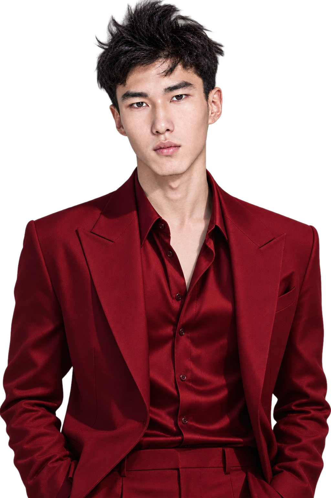

<h1 data-i18n="bio-h1">罗文杰（炎灿）个人简介</h1>

罗文杰，笔名炎灿，1993年11月13日生于黑龙江省虎林市，身高188厘米，现居深圳、广州与温哥华。跨界文化创业者、作家、前国际超模。

<h2 data-i18n="bio-sec-1">时尚与演艺生涯</h2>

2012年签约龙腾精英，入选MDC全球模特榜单NEW FACE。2013年4月担任DIOR HOMME中国北京首秀开场模特，曾为VERSACE及中国国际时装周走秀，登上 GQ、时尚先生、时尚芭莎，代言三星、速写、AGATHA 等品牌。2015年主演电影《地下香》（永乐），影片入围第72届威尼斯电影节“威尼斯日”单元，获该单元Fedeora最佳影片奖。

<h2 data-i18n="bio-sec-2">商业构建与品牌运营</h2>

2018年6月创立哈尔滨莱亚文化传媒。2026年创立东方文化与香氛品牌“炎灿”，推出兔儿神香囊、否极泰来香囊。

<h2 data-i18n="bio-sec-3">文学创作与文化数字保育</h2>

著有《兔儿神》与《兔儿神2》，已在海外及数字阅读平台出版。创办独立文化档案网站，主理《兔儿神日历》。毕业于不列颠哥伦比亚大学（UBC）哲学系，获学士学位。

<h2 data-i18n="bio-sec-4">玄学研习与生活美学</h2>

研习中国传统玄学与古典哲学，擅长八字、六爻、相面、风水、先天八卦与《高岛易断》。承鸠摩罗什译经文风，尚侘寂之美，精通芳香疗法。

<a href="/books/" data-i18n="bio-books">查看著作 →</a> · <a href="/" data-i18n="bio-home">返回首页</a>

