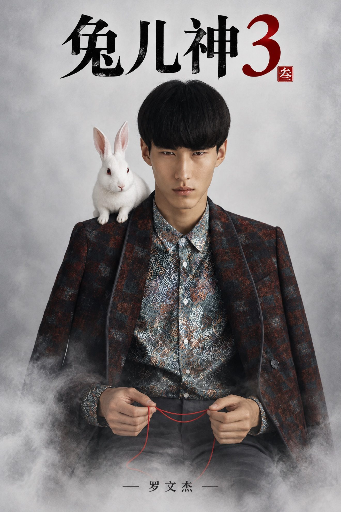
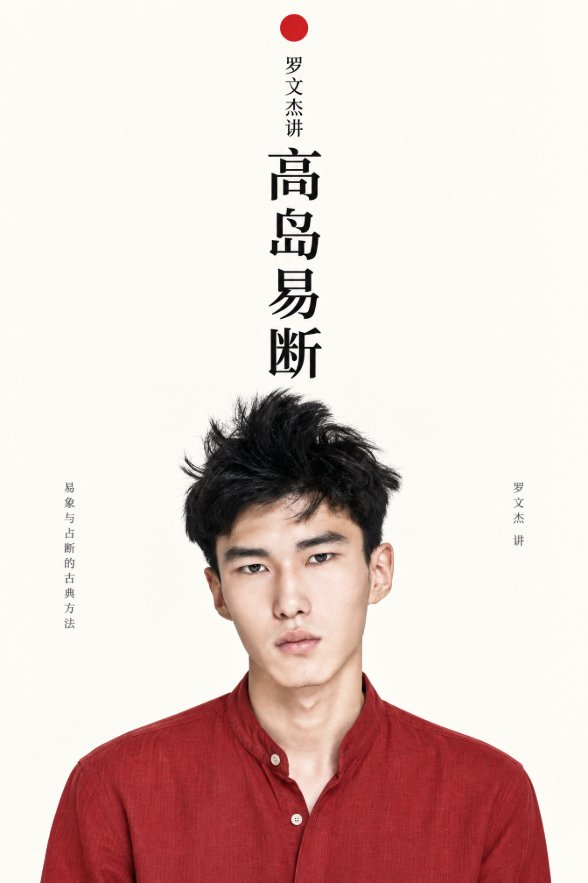
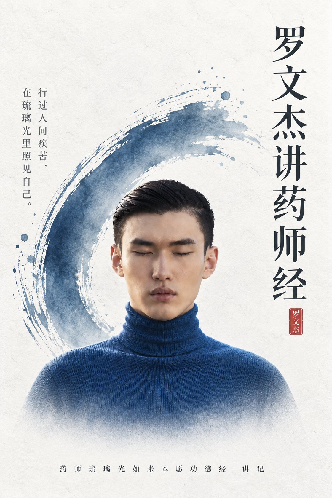
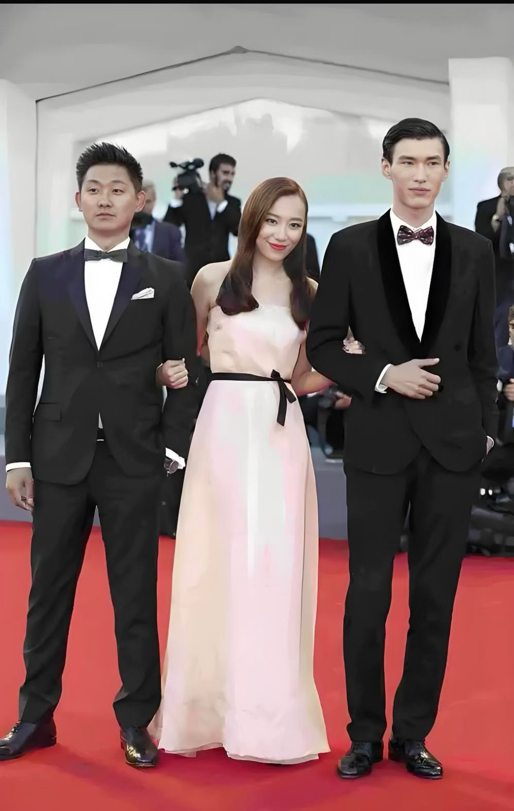
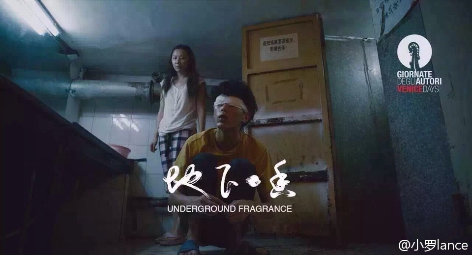
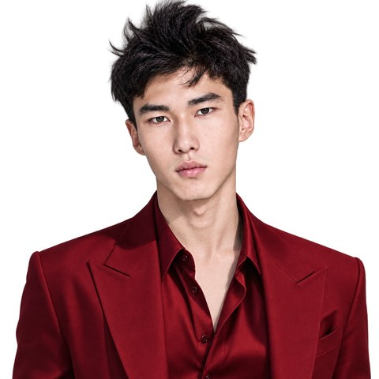

# 图集

照片与封面，点开放大。更多照片陆续补充。

## 书封

  <figure><figcaption>《兔儿神3》英文版封面</figcaption></figure>
  <figure><figcaption>《兔儿神3》中文版封面</figcaption></figure>
  <figure><figcaption>《罗文杰讲高岛易断》封面</figcaption></figure>
  <figure><figcaption>《罗文杰讲药师经》封面</figcaption></figure>

## 威尼斯 · 2015

  <figure><figcaption>2015年威尼斯电影节红毯</figcaption></figure>
  <figure><figcaption>2015年威尼斯电影节拍照环节</figcaption></figure>
  <figure><figcaption>《地下香》剧照</figcaption></figure>

## 肖像

  <figure><figcaption>罗文杰炎灿</figcaption></figure>

<a href="/">返回首页</a>

<button id="lightbox-close" type="button">关闭</button>

