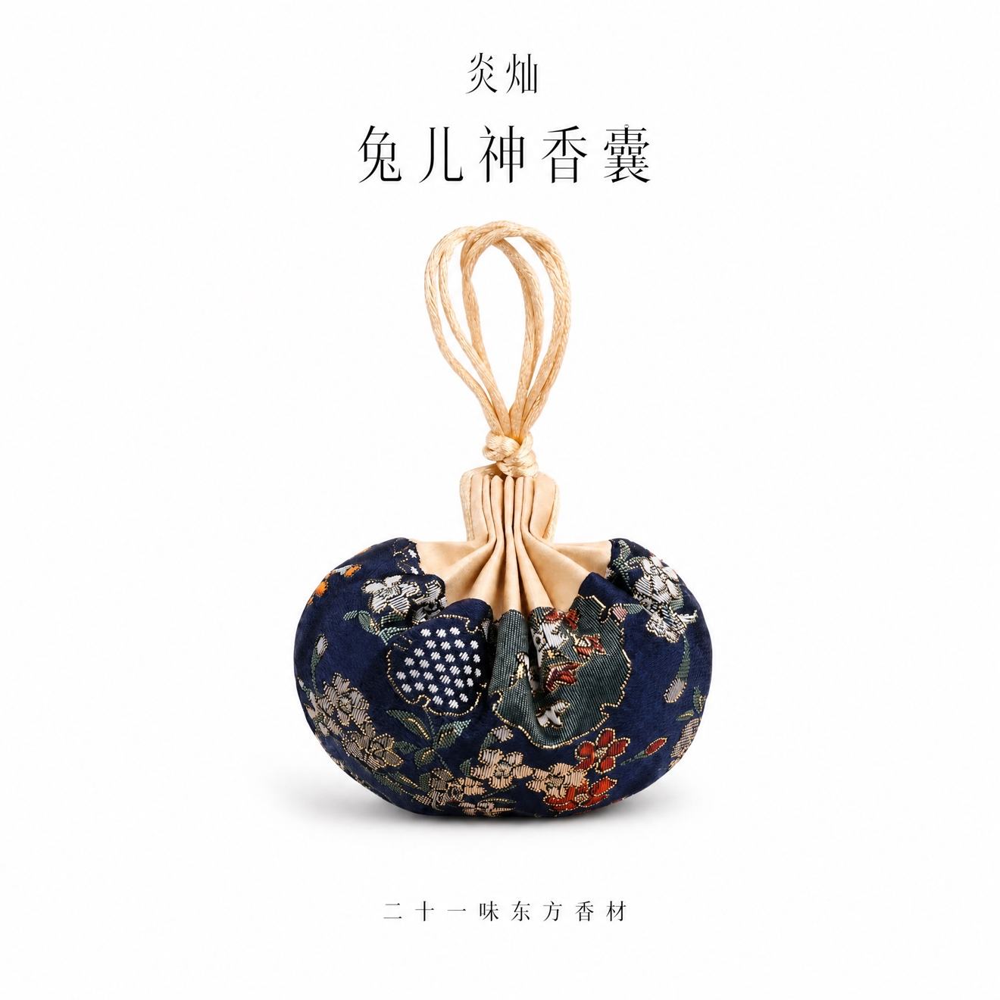
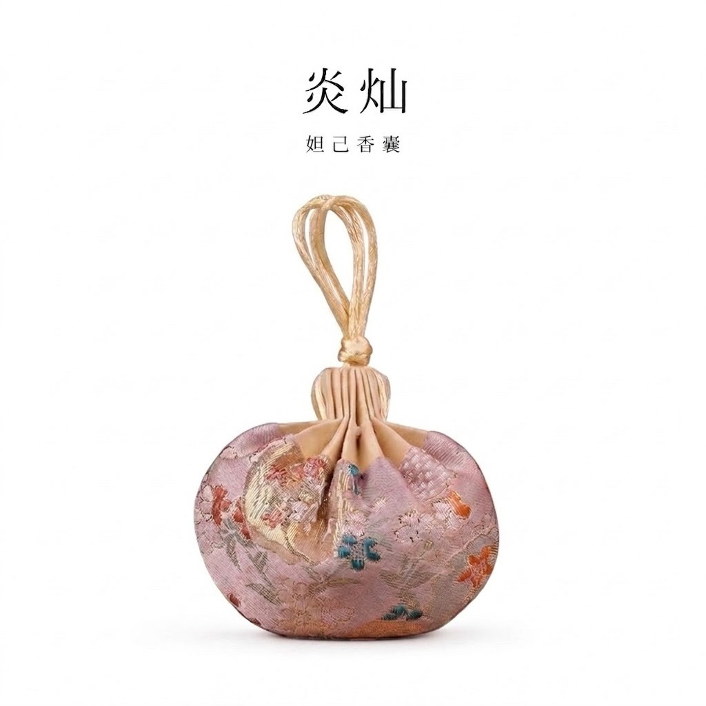
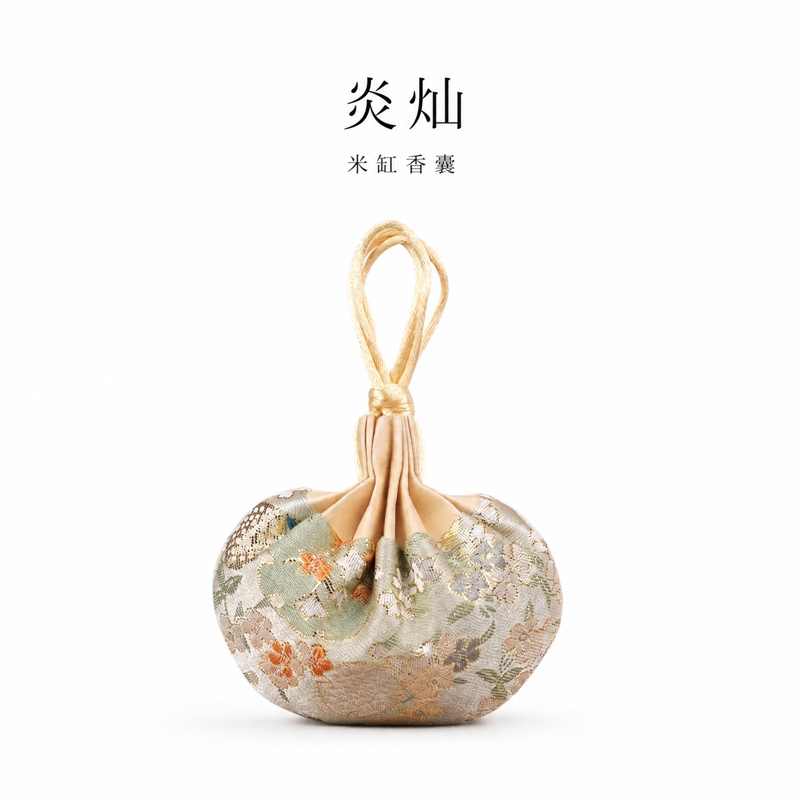

  
  

  

    
Roma Luo

    <h1>罗文杰炎灿</h1>
  

  
以文字记录思想，以影像记录时代， 以东方文化探索生命，以气味连接记忆。

  

<h2 class="home-sec" data-i18n="home-sec-systems">四大体系</h2>

  <a class="sys-card" href="/works/film/">
    
01 · Fashion &amp; Performing Arts

    
ROMA LUO 时尚与演艺

    
DIOR HOMME 首秀开场、VERSACE、GQ、时装周，电影《地下香》。

  </a>
  <a class="sys-card sys-red" href="/books/">
    
02 · Literature &amp; Publishing

    
ROMA LUO 文学与出版

    
《兔儿神》系列与《与兔儿神对话》。

  </a>
  <a class="sys-card sys-gold" href="/books/">
    
03 · Roma Luo Lecture Series

    
罗文杰讲系列

    
已出版 · 《罗文杰讲高岛易断》《罗文杰讲药师经》 已完稿 · 《罗文杰讲萨满》（三卷）《罗文杰讲显化》 撰写中 · 《罗文杰讲神道教》

  </a>
  <a class="sys-card" href="#fragrance">
    
04 · Yancan Fragrance

    
炎灿 YANCAN 东方香氛

    
兔儿神香囊、妲己香囊、米缸香囊。

  </a>

<h2 class="home-sec" data-i18n="home-sec-works">精选作品</h2>

  <a class="work-card" href="/works/magazine/">
    

      
Fashion Editorial

      
个人时尚大片

    

    时尚大片
  </a>
  <a class="work-card" href="/works/film/">
    

      
Film

      
电影《地下香》

    

    《地下香》
  </a>
  
  
  
  
  
  
  <a class="work-card" href="#fragrance">
    

      
Yancan Fragrance

      
炎灿香氛

    

    炎灿香氛
  </a>

<h2 class="home-sec" data-i18n="home-sec-bio">个人档案</h2>

  

    
2012

    
签约龙腾精英，入选 MDC NEW FACE。

  

  

    
2013

    
DIOR HOMME 中国北京首秀开场模特。

  

  

    
2015

    
主演《地下香》，威尼斯日 Fedeora 最佳影片奖。

  

  

    
2018

    
创立哈尔滨莱亚文化传媒。

  

  

    
2026

    
六本书出版；创立炎灿东方香氛品牌。

  

<a href="/bio/" data-i18n="bio-link">完整履历 →</a>

<h2 class="home-sec" id="fragrance" data-i18n="home-sec-fragrance">炎灿香氛</h2>

  

    
    <b>兔儿神香囊</b> · ¥298 · <a href="https://v.douyin.com/Cn5nHlyH8Ps/" target="_blank" rel="noopener" data-i18n="fragrance-buy">抖音商城购买 →</a>
  

  

    
    <b>妲己香囊</b> · ¥298 · <a href="https://v.douyin.com/Pbe2uTeAyTc/" target="_blank" rel="noopener" data-i18n="fragrance-buy">抖音商城购买 →</a>
  

  

    
    <b>米缸香囊</b> · ¥298 · <a href="https://v.douyin.com/s9ryhyQnQ3Y/" target="_blank" rel="noopener" data-i18n="fragrance-buy">抖音商城购买 →</a>
  

<h2 class="home-sec" data-i18n="home-sec-biz">品牌与商业合作</h2>

  <a class="biz-card" href="/books/">
    
Publishing

    
出版合作

    
已出版 6 本，另有待出版与撰写中作品。

  </a>
  <a class="biz-card" href="/bio/">
    
Media &amp; Business

    
媒体与商务联系

    
请通过微信公众号“兔儿神胡天保”或 Instagram @luoyancan 联系。

  </a>

<a href="/archive/" data-i18n="foot-archive">档案</a> · <a href="/books/" data-i18n="foot-books">全部著作</a>

