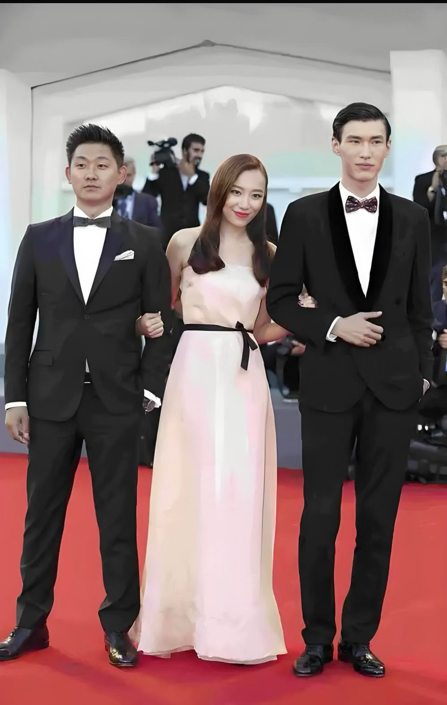
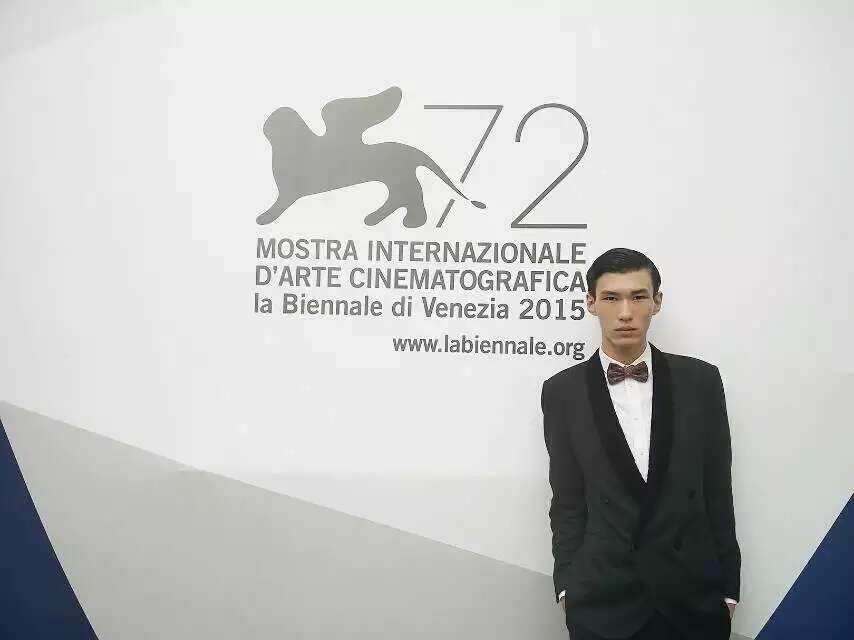
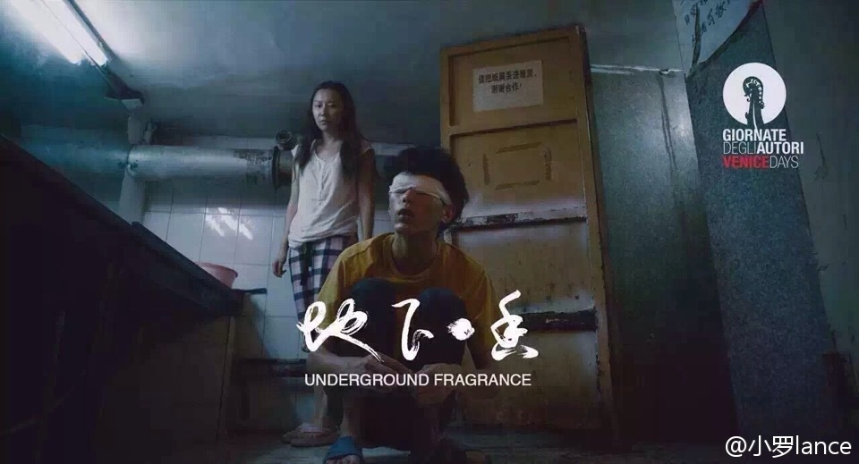

# 影视

Film &amp; TV · 电影与电视作品

## 《地下香》

2015年，罗文杰跨界大银幕，在影片《地下香》中担纲男主角，饰演“永乐”一角；该片入围第72届威尼斯电影节“威尼斯日”单元，并获该单元 Fedeora 最佳影片奖（奖项属于影片）。

<iframe src="https://www.youtube.com/embed/89crwGblfrA" title="2016台北電影節 │ 地下香 Underground Frangrance" loading="lazy" allow="accelerometer; autoplay; clipboard-write; encrypted-media; gyroscope; picture-in-picture; web-share" allowfullscreen></iframe>

2016 年第 18 届台北电影节官方预告（页面标题原样：「2016台北電影節 │ 地下香 Underground Frangrance」）· <a href="https://youtu.be/89crwGblfrA" target="_blank" rel="noopener">在 YouTube 上观看</a>

电影 · 2015 · DCP · 彩色 · 75分钟 · 法国 / 中国 导演：鹏飞 · 罗文杰饰演北漂青年永乐 2015 威尼斯影展威尼斯日最佳影片 · 2015 芝加哥影展青年导演最佳影片 · 2015 釜山影展 第72届威尼斯电影节“威尼斯日”单元入围，并获该单元 Fedeora 最佳影片奖（奖项属于影片）

## 《今晚80后脱口秀》

罗文杰曾参与《今晚80后脱口秀》。

## 威尼斯 · 2015

  <figure><figcaption>2015年威尼斯电影节红毯</figcaption></figure>
  <figure><figcaption>2015年威尼斯电影节拍照环节</figcaption></figure>
  <figure><figcaption>《地下香》剧照</figcaption></figure>

照片点开放大。更多影视剧照与视频陆续补充。

<a href="/">← 返回首页</a> · <a href="/works/ads/">广告 →</a> · <a href="/works/magazine/">杂志 →</a>

<button id="lightbox-close" type="button">关闭</button>

